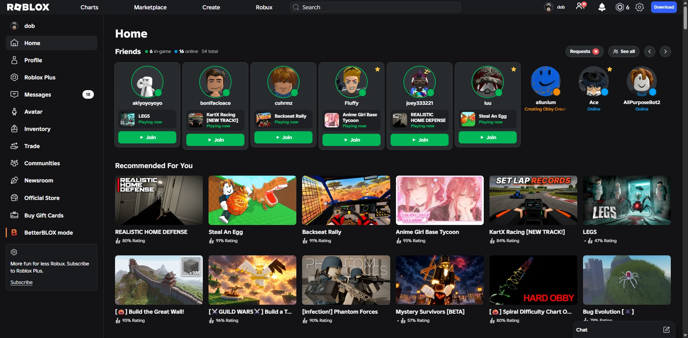
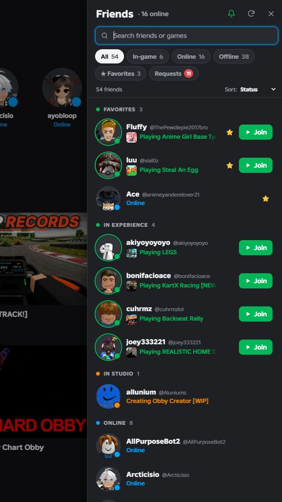

# Better Roblox Friends

Better Roblox Friends is a Chrome extension that improves how you view friends on roblox.com. Your home page gets a row of friend tiles showing who's on and what they're playing, and a Friends button in the top bar opens the full list in a panel from any page. You don't need the friends page to see who's around.

Unofficial, not affiliated with Roblox.

- Each friend's status: online, in a game, or in Studio
- Join a friend's game in one click
- Last online time and last game played for offline friends
- Search by friend or game, with filters and sorting
- Favorites, with a desktop notification when they come online or start a game
- Accept or decline friend requests from the panel

The friends row on the home page becomes tiles:

The Friends button in the top bar opens the panel. Esc closes it.

Presence is checked about once a minute in the background, even with no Roblox tab open. The bell in the panel mutes notifications.

## Install

It's not in the Chrome Web Store, so load it manually:

1. Download or clone this repo.
2. Open `chrome://extensions` (Edge and Brave work too) and turn on Developer mode.
3. Click Load unpacked and select the repo folder.
4. Reload roblox.com.

After pulling an update, click the reload icon on the extension's card. Chrome may ask you to approve new permissions.

## Permissions

- `storage`: favorites and settings (synced with your Chrome profile), last-online data (local only)
- `alarms`: the once-a-minute check
- `notifications`: favorite alerts
- `declarativeNetRequest`: sets `Origin` and `Referer` on the extension's own requests to roblox.com, which Roblox needs for some of them
- Access to `roblox.com` and `rbxcdn.com`: friend data and thumbnails

Requests go to Roblox only. No server, no analytics.

## Files

- `manifest.json`: Manifest V3 config
- `content.js`: home tiles and the side panel
- `engine.js`: Roblox API calls and presence logic
- `background.js`: service worker that polls and sends notifications
- `styles.js`, `page.css`: styling

## License

MIT. See [LICENSE](LICENSE).
